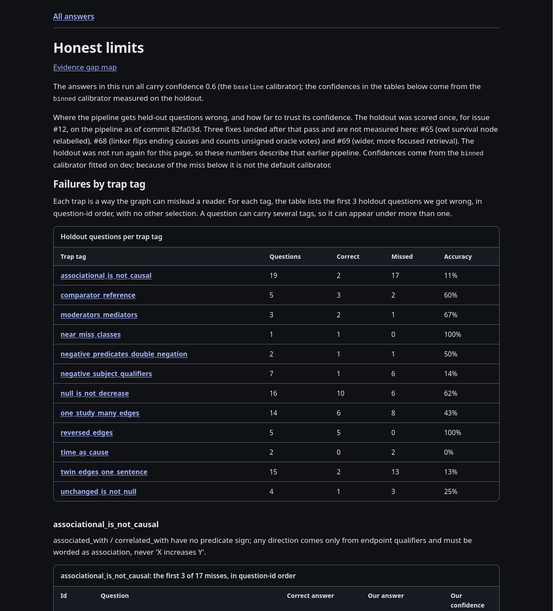

# camoreasoning

Evidence Jam 2026, Lane 2. Ask "What effect does X have on Y?" and get an answer from the CAMO (Causal Mosaic) causal graph: direction, certainty and confidence, the edges it rests on, and a plain `no_evidence` when the graph has nothing. The judged run makes **no LLM calls**. The brief is in [CHALLENGE.md](CHALLENGE.md).

**[Pitch deck (PDF)](slides/goose-chain.pdf)**


| Evidence gap map | Honest limits |
|---|---|
|  |  |

## Quick start

Needs only `python3` >= 3.10. The first run creates `.venv` from the pinned `requirements.txt` (PyYAML only). It never downloads anything at run time.

```sh
./run.sh questions.yaml answers.json   # answers.json + evidence pages, gap map and limits in outputs/
./ask.sh "What effect does prescribed burning have on native plant richness?"   # one question; --json for raw output
```

`ask` accepts free wording. Any side of the question the rules can't place goes to the LLM in one call (8 s timeout), configured by `BRINE_URL`, `BRINE_MODEL` and `BRINE_API_KEY` in the environment or `.env` (see `.env.example`). The batch run doesn't need them. From Python: `camoreasoning.pipeline.ask(question)` and `run_file(questions, answers)`.

## How it works

The graph is only read, never changed. Offline, a taxonomy of 82 classes labels about 6,000 graph nodes ([`taxonomy/`](taxonomy/)). Each question then goes through four steps:

1. **Parse** the question into a cause and an outcome. The template form and 16 freer shapes are covered.
2. **Link** each side to graph nodes by class label, synonym, phrase, node name and word stem (0 calls). Extra words narrow the match, and "cessation of X" is read as the opposite of X.
3. **Interpret** each edge as its sentence reads: node polarity × predicate sign. A null result is `no_effect`, double negations are handled, and an unsigned association marks evidence but never outvotes a signed edge.
4. **Decide and write:** one vote per study, and a direction needs at least 2/3 of them, otherwise `mixed`. Certainty is the median edge grade, one level lower if mixed or all-associational. The answer is a templated sentence, and associational evidence never gets a causal verb.

The locked rules (D1–D6) are in [ROADMAP.md](ROADMAP.md).

## Results

Dev split, default pipeline (re-measured 2026-11-15). These are model-labelled gold sets in [`experiments/devsets/`](experiments/devsets/), not the hidden set.

| | class dev (n = 83) | node dev (n = 184) |
|---|---|---|
| Accuracy (status + direction) | **0.687** | **0.630** |
| no_evidence precision / recall | 0.94 / 0.89 | 0.71 / 0.82 |
| Direction accuracy (answerable) | 0.54 | 0.54 |
| Cited-edge precision / recall | 0.48 / 0.59 | 0.44 / 0.57 |
| Calibration error (ECE) | 0.087 | 0.030 |
| LLM calls · tokens per question | **0 · 0** | **0 · 0** |

Reproduce: `python -m camoreasoning eval experiments/devsets/<class_gold|gold_annotated>.yaml --split dev`. Given the gold edges, direction is 1.0, so most of the remaining loss is in retrieval. Experiments that lost are kept with their numbers in [`experiments/`](experiments/README.md).

## Limits

- **Out of scope:** multi-part questions (so 9 of 10 practice answers are `no_evidence`), multi-hop chains and effect sizes.
- **Confidence** is a constant 0.6, because the fitted calibrator missed its holdout target (ECE 0.187 against 0.05).
- **Certainty** is the weakest output: scored against a stricter reading of the gold, dev accuracy falls to about 0.48 ([scoring variants](experiments/results/scoring_variants.md)).
- Every run writes `outputs/limits.html`, which lists holdout failures by trap tag.

## Extend

Each stage (parser, linker, retriever, interpreter, aggregator, grader, calibrator, citer, renderer, extras) is an interface in [`components.py`](src/camoreasoning/components.py), and the data passed between stages is defined in [`contracts.py`](src/camoreasoning/contracts.py). A new idea is a new file in `src/camoreasoning/strategies/<stage>/` with `@register(stage, name)`; [`citer/precise.py`](src/camoreasoning/strategies/citer/precise.py) is a short example. A stage gets the graph, taxonomy, settings and the metered LLM through `ctx`.

```sh
pytest tests/contracts -k <name>                                                   # contract tests find it automatically
CAMOREASONING_STRATEGY_CITER=<name> ./run.sh questions.yaml answers.json           # run it
python -m camoreasoning -s citer=<name> eval experiments/devsets/class_gold.yaml --split dev   # score it
```

Make it the default in [`strategies/__init__.py`](src/camoreasoning/strategies/__init__.py) once the eval shows it wins.

## Develop

```sh
mise run setup   # deps + git hooks (hk: lint, Conventional Commits)
mise run check   # lint, tests, run, validate
mise run eval    # accuracy, calibration, calls per question
```

Without mise: `pip install -e . -r requirements-dev.txt && pytest`. Offline tools: `annotate` (bulk labelling), `calibrate` and `probe` (LLM endpoint check).

**Layout:** `causal_graph.{json,yaml}` and [`schema/`](schema/) are the organizers' graph and schema · [`src/camoreasoning/`](src/camoreasoning/) is the engine · [`taxonomy/`](taxonomy/) holds the offline labels · [`experiments/`](experiments/README.md) · [`product/`](product/) holds the page template · [`slides/`](slides/README.md) has the deck source · [`docs/`](docs/), [`scripts/`](scripts/), [`tests/`](tests/).
