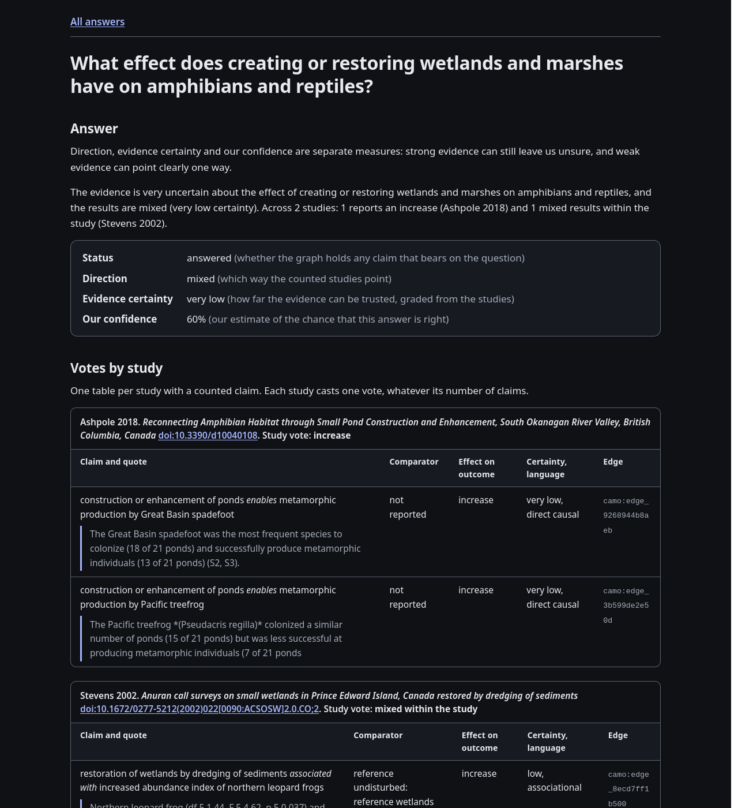
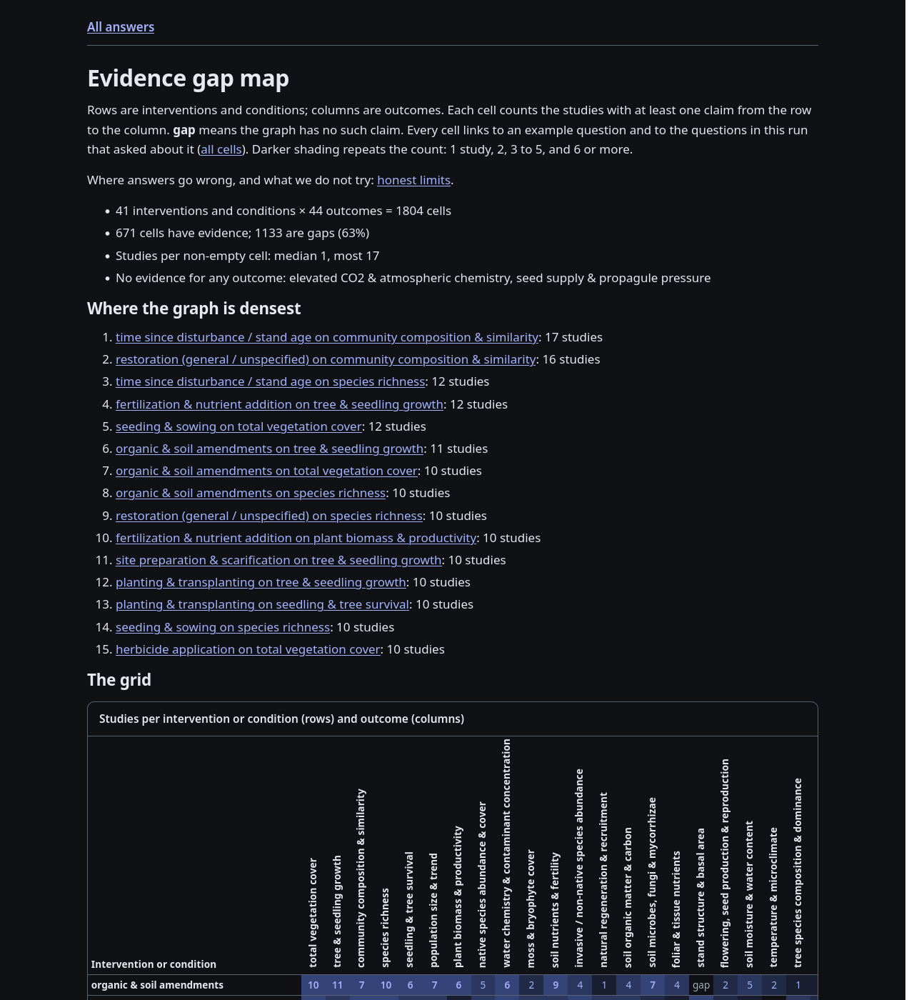

# camoreasoning

Evidence Jam 2026, Lane 2. Ask "What effect does X have on Y?" and it answers from the CAMO (Causal Mosaic) causal graph. Each answer gives the direction, certainty and confidence, cites the edges it rests on, and says so when the graph has no evidence. The default run makes **no LLM calls**. The challenge brief is in [CHALLENGE.md](CHALLENGE.md).

**Quick start** (needs only `python3` >= 3.10; details in [Run](#run)):

```sh
./run.sh questions.yaml answers.json   # batch: answers.json + evidence pages in outputs/
./ask.sh "What effect does prescribed burning have on native plant richness?"   # one question of your own
```

## Why this design

Every hidden answer is in the graph, so the job is to find the right edges and read them faithfully. About a third of questions have no evidence at all, and saying so is a correct answer. Faithfulness forbids overclaiming, so each answer is decided by fixed rules and written from a template, and its only hedge is the certainty of the evidence. Energy is scored per LLM call, so the judged run makes 0 calls. The LLM is used offline, to label graph nodes, and on the `ask` path only, to read wording the rules can't place.

## What it can and can't answer

- **Works:** "What effect does X have on Y?" and close paraphrases, such as "Does X reduce Y?".
- **Freer wording:** `ask.sh` uses one LLM call to read the sides of a question the rules can't place.
- **Doesn't work:** multi-part questions (like most of [`questions.yaml`](questions.yaml), which is why 9 of 10 practice answers are `no_evidence`), multi-hop chains (A affects B, B affects C), and effect sizes.
- **Honest limits:** each run writes `outputs/limits.html`, linked from `outputs/gapmap.html`. It lists where the pipeline fails on the holdout and what it never tries.

Confidence is a constant 0.6 in this release: a fitted calibrator missed its holdout target (ECE, expected calibration error, 0.187 against 0.05), so we ship the constant and show the miss on the limits page.

Certainty is the weakest output. It follows the D4 rule (the median edge grade, one level lower if mixed or all-associational). The dev numbers below score correctness on status and direction. If correctness also required the exact certainty, measured against a different reading of the gold (for example the maximum edge grade), dev accuracy would fall to about 0.48 ([`experiments/results/scoring_variants.md`](experiments/results/scoring_variants.md), #99).

## Run

One command, from a clean checkout:

```sh
./run.sh questions.yaml answers.json
```

- **Needs:** `python3` >= 3.10. The first run creates `.venv` from the pinned `requirements.txt` (PyYAML only), using uv if it's installed. At run time it never downloads anything.
- **LLM:** it reads `BRINE_URL`, `BRINE_MODEL` and `BRINE_API_KEY`, from the environment or from `.env` (see `.env.example`). The batch run doesn't need them. With the LLM unreachable, `run.sh` still writes valid answers.
- **Output:** `answers.json`. It also writes to `outputs/`: one evidence page per question (listed in each answer's `extras`), an index, a gap map of where the graph has and lacks evidence, and `footprint.json` (LLM calls, tokens, estimated Wh).

To ask your own question:

```sh
./ask.sh "What effect does mulch have on invasive species abundance?"
```

`ask` accepts free wording. It uses the same rules, and sends any side they can't place confidently to the LLM in one call with an 8 s timeout. If the question still can't be read, it says which side it couldn't place and suggests the nearest classes. It writes its pages to `outputs/ask/`, so it never overwrites a run's pages.

### Screenshots






## Use it from code

`./ask.sh --json "…"` prints one answer object. In Python:

```python
from camoreasoning.pipeline import ask, run_file
answer = ask("What effect does mulch have on invasive species abundance?")  # one answer dict, plus footprint
summary = run_file("questions.yaml", "answers.json")  # writes answers.json and outputs/; returns a summary
```

The answer fields are defined in [CHALLENGE.md](CHALLENGE.md#answer-format).

## Layout

- `causal_graph.json`, `causal_graph.yaml` and [`schema/`](schema/): the organizers' graph and its CAMO schema.
- [`src/camoreasoning/`](src/camoreasoning/): the engine. Each stage has its strategies in `strategies/<stage>/`.
- [`taxonomy/`](taxonomy/): the offline classes, synonyms and node labels.
- [`experiments/`](experiments/README.md): measured experiments, including the ones that lost.
- [`product/`](product/): the page template and CSS.
- [`docs/`](docs/), [`scripts/`](scripts/) and [`tests/`](tests/): notes, helper scripts and the test suite.
- `hk.pkl`: the git hooks config for hk (lint and Conventional Commits).

## How it works

The graph is only read, never rewritten. A small taxonomy (82 broad classes, with about 6,000 graph nodes labelled into them) is built offline in [`taxonomy/`](taxonomy/). Nodes are labelled by class phrases, by audited graph wording that only labels nodes and never links a question ([`label_synonyms.yaml`](taxonomy/label_synonyms.yaml), proposed offline by bge-base-en-v1.5), and by one offline LLM pass for the rest. Every question then goes through four steps:

1. **Read the question.** Split it into a cause and an outcome (`parser/freeform`). The template form and 16 freer shapes are covered.
2. **Link each side to the graph** (`linker/cessation`, 0 calls), trying these in order: an exact class label or synonym, a class phrase contained in the wording, the closest node names, then word stems. Words the class doesn't cover narrow the side to the nodes that name them (`retriever/focus`), so "ericaceous shrub cover" isn't outvoted by all plant cover. A cause that ends something ("cessation of …") is read as the opposite of the thing that stops.
3. **Read each edge the way its sentence reads** (`interpreter/unsigned`). Sign = the question-relative node polarities × the predicate's sign. A null result is a `no_effect` vote, never a decrease. Double negations ("prevents decreased Y") are pinned to their sentences. An association that names no direction counts as an unsigned vote: it marks the question as having evidence but never outvotes a signed edge. Other edges with no usable sign are kept out and listed.
4. **Decide, grade, cite, write** (`aggregator/studies`, `grader/rubric`, `citer/precise`, `renderer/faithful`, `calibrator/baseline`):
   - **Direction:** one vote per study. A direction wins with at least 2/3 of studies, otherwise the answer is `mixed`.
   - **No evidence:** with no usable vote the answer is `no_evidence`, and `searched_for` says what was searched.
   - **Certainty:** the median edge grade, one level lower if mixed or all-associational, never `high`.
   - **Text:** a templated sentence whose only hedge is that certainty. Associational evidence never gets a causal verb.

   - **Confidence:** a constant 0.6 (`calibrator/baseline`), for the reason given above.

   No LLM writes the answers. The `extras/gapmap` stage then writes the evidence pages, the gap map (`gapmap.html`, `gapcells.html`) and the honest-limits page (`limits.html`) into `outputs/`.

The locked rules behind these steps (D1–D6) are in [ROADMAP.md](ROADMAP.md).

## Results

Dev split, default pipeline, first measured at commit `205ca6c` (#92) and re-measured on 2026-11-15 after the `precise` citer became the default (#100): only cited-edge precision and recall changed. These are model-labelled gold sets in [`experiments/devsets/`](experiments/devsets/), not the hidden set.

| | class dev (n = 83, hidden-set wording) | node dev (n = 184, independent wording) |
|---|---|---|
| Accuracy (status + direction) | **0.687** | **0.630** |
| no_evidence precision / recall | 0.94 / 0.89 | 0.71 / 0.82 |
| Direction accuracy (answerable) | 0.54 | 0.54 |
| Cited-edge precision / recall | 0.48 / 0.59 | 0.44 / 0.57 |
| Calibration error (ECE) | 0.087 | 0.030 |
| LLM calls · tokens per question | **0 · 0** | **0 · 0** |

Reproduce with `python -m camoreasoning eval experiments/devsets/<class_gold|gold_annotated>.yaml --split dev`. The class set uses the taxonomy to pick its class pairs, so the node set is the stricter check. Given the gold edges, the engine's direction is 1.0 on both sets. The remaining loss is mostly retrieval: the right edges aren't found, or extra ones come along (see ROADMAP items 5, 8 and 13). Experiments that didn't win are kept with their numbers under [`experiments/`](experiments/), for example the LLM-assisted linker and static embeddings. Embeddings link too many question sides wrongly to run at judging time; offline, BGE only proposes node-label wording, which an audit then filters ([`experiments/embeddings/bge_synonyms/`](experiments/embeddings/bge_synonyms/README.md)).

## Extend it in 10 minutes

Each stage is an interface in [`src/camoreasoning/components.py`](src/camoreasoning/components.py): parser, linker, retriever, interpreter, aggregator, grader, calibrator, citer, renderer and extras. A new idea is a new strategy file. Nothing else changes. The commands below assume the dev setup (see [Develop](#develop)).

**1. Write the strategy.** For example, `src/camoreasoning/strategies/citer/one_per_study.py`:

```python
from camoreasoning.components import Citer, Context
from camoreasoning.contracts import Verdict
from camoreasoning.registry import register


@register("citer", "one_per_study")
class OnePerStudy(Citer):
    def cite(self, verdict: Verdict, ctx: Context) -> list[str]:
        if verdict.status != "answered":
            return []
        first = {}
        for v in verdict.included:
            first.setdefault(v.doc_id, v.edge_id)
        return list(first.values())
```

**2. Check it against the contract.** The tests find every registered strategy, with no test code to write:

```sh
source .venv/bin/activate
pytest tests/contracts -k one_per_study
```

**3. Run and score it** next to the default:

```sh
CAMOREASONING_STRATEGY_CITER=one_per_study ./run.sh questions.yaml answers.json
python -m camoreasoning -s citer=one_per_study eval experiments/devsets/class_gold.yaml --split dev
```

The eval prints JSON. Compare these keys with the default's: `overall.accuracy`, `C calibration.ece`, `B engine.edge_precision` and `edge_recall`, and `D energy+release.calls_per_question`.

**4. Make it the default** in [`src/camoreasoning/strategies/__init__.py`](src/camoreasoning/strategies/__init__.py), once the eval shows it wins.

Everything a stage may use comes through `ctx`: the graph, the taxonomy, settings, and the LLM. `ctx.llm` is metered and batched, and it is the only allowed network access. The data each stage passes on is defined in [`contracts.py`](src/camoreasoning/contracts.py), and those types are frozen.

## Develop

```sh
mise run setup   # deps + git hooks
mise run check   # lint, tests, run, validate: the gate for every change
mise run eval    # accuracy, calibration and LLM calls per question on the dev split
```

Without mise: `pip install -e . -r requirements-dev.txt && pytest`.

Offline tooling:

- `python -m camoreasoning annotate …` is the bulk labelling harness. Strong models fill strictly validated JSONL chunks, and a CSV round trip handles human review.
- `calibrate` fits the calibrator on gold dev items.
- `probe` checks the LLM endpoint.

Owners, locked decisions and self-check targets are in [ROADMAP.md](ROADMAP.md). Commits follow Conventional Commits (`feat(linker): ...`), and hk enforces this.
