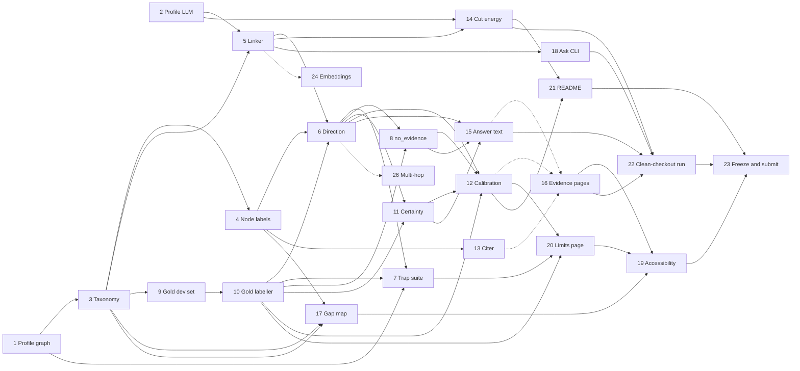

# Roadmap

**Submission:** the last commit before **Sun Nov 15, 18:00 EST**. Freeze at 16:00.

**Ranking:** the winner is the highest total. 60 points are scored by script on a hidden question set and 40 by judges.

### Points key

Every item lists the buckets it moves.

| Key | Points | What it covers |
|---|---|---|
| **D17** | 17 | Direction, null vs effect, certainty, not fooled by traps |
| **C14** | 14 | Confidence calibration, plus `no_evidence` with `searched_for` (about 1/3 of hidden questions) |
| **P9** | 9 | Answers parse; cited edges exist and bear on the question |
| **E12** | 12 | Energy per question, ranked against other teams. Counts only if at least half our answers are correct, so never trade accuracy for it |
| **R8** | 8 | Runs from a clean checkout. If more than 5% of entries don't parse, all scripted points are halved |
| **J40** | 40 | Judges: method, faithfulness, honest limits, user value, craft and reuse, W3C accessibility |

### Format

- **★ n/5:** how hard to try.
- **Streams:** A = taxonomy and linking, B = reasoning engine, C = eval and calibration, D = energy, product and release.
- **`stage`:** the component in `components.py` that the item lives in. Work is a new strategy for that stage.

### Dependency tree

`A --> B` means B needs A's output first. Numbers are the items below. Item 0 is done and feeds everything, so it is omitted.

**Critical path:** 1 → 3 → 4 → 5 → 6 → 8 → 12 → 16 → 22 → 23. Anything slipping on it moves the submission.

**Layers (what can run in parallel):**

| Layer | Items | Needs |
|---|---|---|
| L0 | 1, 2 | nothing |
| L1 | 3 | 1 |
| L2 | 4, 5, 9 | 3 (5 also uses 2) |
| L3 | 10, 6, 17, 18 | 9 for 10; 4 and 5 for 6; 3 and 4 for 17; 5 for 18 |
| L4 | 7, 8, 11, 13, 14 | 6 (13 needs 4; 14 needs 5 and 2) |
| L5 | 12, 15 | 6, 8, 11 and 10 |
| L6 | 16, 20, 21 | 12, 13, 15 for 16; 7, 10, 12 for 20; 12, 14 for 21 |
| L7 | 19, 22 | pages built (16, 17, 20); 22 needs 14, 15, 16, 18 |
| L8 | 23 | 19, 21, 22 |

**Notes:**
- 10 (the independent gold labeller) is also an input to tuning 6, 7, 8, 11 and 12. Items 4, 5 and 9 can start as soon as 3 lands, and 9 can run in parallel with 4.
- 14 and 22 must re-run after any change that alters accuracy, so treat them as gates rather than one-off steps.

## Decisions (locked Fri Nov 13; Justin overrides only at the Sat 22:00 audit)

- **D1 Associational edges count.** `associated_with` and `correlated_with` are 45% of edges. They vote, signed through the qualifiers, and are tagged associational. The grader may cap their certainty. Answer text says "is associated with" when every included edge is associational, never "causes".
- **D2 Direction rubric.** One vote per study. A direction (increase, decrease or no_effect) wins if at least 2/3 of studies give it, otherwise `mixed`. Nulls and `unchanged` outcomes are `no_effect` votes. `unclear` means no study gives a usable sign. The baseline aggregator uses 2/3.
- **D3 no_evidence.** It applies when no included vote exists: only reversed edges, only non-directional predicates (moderates, mediates, precedes, regulates), or a non-null edge with an `unchanged` cause. A null (`negated: true`) still votes `no_effect` whatever its qualifiers, because the schema encodes nulls only as negated (clarified Sat Nov 14, #9 audit). `searched_for` names the classes searched and any reversed edges.
- **D4 Gold certainty.** The median `certainty_grade` of the relevant edges, one level lower if `mixed` or if every edge is associational. Never `high`, because the graph has none.
- **D5 Gold is independent.** Dev questions are written by a model from graph seeds (edges and random node pairs), not from our taxonomy. Gold finds candidate edges with its own lexical prefilter and reads the sentences. It never uses `node_labels`, the taxonomy or engine code. Any strong model works. Expect a Claude Code session with the `labeler` agent.
- **D6 Runtime energy.** 0 LLM calls for template questions, and at most one batched call for the rest. Offline LLM use is unlimited.

## Owners and Saturday deliverables (done by Sat 18:00)

| Owner | Stream (items) | Starts from (all committed now) | Delivers | Self-check (targets) |
|---|---|---|---|---|
| Justin | A: taxonomy, node labels (1, 3, 4) | graph, `mise run profile`, `annotate` task `node_labels` | `taxonomy/classes.yaml` + `node_labels.jsonl` v1 | `annotate review-*` agreement ≥ 0.90 on 100 labels; ≥ 80% of edges with both ends labelled (`taxonomy` prints it); scorecard **A** `retrieval_recall` ≥ 0.8 once gold lands |
| #2 | B: linker fallback, interpreter, aggregator, no_evidence, grader, citer, calibrator `fit`, ask (5–8, 11–14, 18) | fixture taxonomy (`CAMOREASONING_TAXONOMY_DIR=tests/fixtures/taxonomy`), contract tests, `eval:fixture` | strategies under `strategies/<stage>/`, `calibrate` working | scorecard **B**: oracle direction ≥ 0.85, certainty ≥ 0.75, edge precision ≥ 0.9, recall ≥ 0.7, `interpreter_effect_accuracy` ≥ 0.9; **D** `calls_per_question` ≤ 0.04; ask under 10 s |
| #4 | C: dev questions, gold, audit (9, 10, 20), renderer wording (15), README (21) | `annotate` tasks `questions` → `gold`, `.claude/agents/labeler.md` | `experiments/devsets/gold_annotated.yaml`: ≥ 120 items, about 1/3 empty, trap-tagged, about 20% holdout | `annotate check` clean; review agreement ≥ 0.85 on 40 items; every trap tag ≥ 3 items (`by_tag`) |
| #3 | D: evidence pages, gap map, accessibility (16, 17, 19), node-label audit for A | `mise run run:fixture` (real answered traces) | `extras` strategy and `product/` | contract `test_extras` green; WCAG checklist in item 19 ticked; label audit CSV returned to Justin |

**Flat dependencies.** No stream waits on another to start or to finish its code. Two data drops land around Sat 12:00: taxonomy v1 from A and gold v1 from C. When they land, owners re-run `mise run eval` and tune. At Sat 22:00 Justin flips `strategies/__init__.py` defaults on eval evidence, runs `mise run calibrate`, checks holdout (`mise run eval:holdout`), then runs `mise run judge-sim`.

**How to work.**
- Branch `<name>/<stream>`. Touch only your own stage folders and artifacts. `strategies/__init__.py` defaults are Justin's.
- Gate: `mise run check`. Self-evaluate with `mise run eval` (gold) or `mise run eval:fixture` (smoke). The output is a per-stream scorecard.
- Bulk labelling, for any task (`cr` = `python -m camoreasoning`, inside the mise venv):
  1. `cr annotate export <task> [-n N --chunk 40]`
  2. Edit `experiments/annotate/<task>/PROMPT.md`. It is yours.
  3. In Claude Code: "Use the labeler agent on task `<task>`, chunks 0001–00NN, 4 in parallel." Or use the endpoint: `cr annotate run <task> --workers 4`.
  4. `cr annotate check <task>` until clean, then `cr annotate merge <task>`.
  5. For human audit: `cr annotate review-export <task> -n 40 [--stratify direction]`. Fill `ok` and `human_*` in a spreadsheet, then run `cr annotate review-import <task>` and `merge` again. Human rows win.
- Pipelines:
  - **Gold:** `cr annotate … questions` → `cr -s devset_builder=annotated devset --build-only` → `cr annotate … gold` → `cr -s gold_labeler=annotated devset --gold-only`.
  - **Labels:** `cr annotate … node_labels` → `cr -s node_labeler=annotated taxonomy --labels-only`.

## Phase 0 — Foundation (done)

- [x] **0. Frozen contracts, tooling and baselines.** ★ 5/5 · all
  - **Why:** four people and many agents work in parallel without breaking each other.
  - **Done when:** `mise run check` and `mise run robust` are green, and `./run.sh` works from a clean clone with 0 LLM calls.
  - **Points:** R8, P9 floor.

## Phase 1 — Understand (Fri night)

- [x] **1. Profile the CAMO graph.** ★ 4/5 · A · `experiments/`
  - **Why:** the taxonomy, sign rules and traps must fit this graph, not CAMO in general. Every edge is graded moderate, low or very_low, never high. There are no assessment edges. 5,067 of 6,814 nodes appear in only one edge. 661 of 1,906 signed edges flip sign under naive reading. There are 1,093 null findings and 203 `unchanged` nodes.
  - **Done when:** `mise run profile` output is reviewed. Cause and outcome vocabulary is dumped. A trap inventory with counts goes in `experiments/`, including twin edges from one sentence and `associated_with` with qualifiers.
  - **Points:** feeds D17 and C14.
  - **Done:** the review is in `experiments/profile/README.md`. The vocabulary is in `vocab_*.tsv`, and the trap inventory, with 5 examples per trap, is in `experiments/results/trap_inventory.json`. Every "Why" number checked out.
    - **Fragmentation:** 4,801 of 4,820 raw cause→outcome pairs rest on one document, so item 3 must merge hard.
    - **Open for item 6:** all 39 `prevents`/`disrupts` edges double-negate ("prevents decreased Y"), so the schema sign product reads the opposite of the sentence.
    - **For items 6 and 8:** the 121 `unchanged` objects are untagged nulls.
- [x] **2. Profile the instrumentation.** ★ 4/5 · D · `llm.py` usage
  - **Why:** E12 is estimated from tokens on the endpoint. We need to know whether thinking-off really works, whether usage is reported, and how latency behaves.
  - **Done when:** a smoke call through `ctx.llm` records prompt and completion tokens in `footprint.json`. Completion tokens are small, so no hidden reasoning. The batch chunk size is chosen, and the baseline tokens per question are written down here.
  - **Points:** E12, R8.
  - **Done:** the probe is in `experiments/results/endpoint_probe.json` and the chunk sweep in `experiments/results/llm_chunk_size.json` (`experiments/llm_profile/chunk_size.py`).
    - **Usage and thinking:** the endpoint reports real prompt and completion tokens. Thinking-off holds: an "OK" reply costs 2 completion tokens and has no `<think>`. JSON-schema `response_format` works.
    - **Cost is the prompt:** 0.2 s for a short prompt, about 5.6 s for 2.6k prompt tokens. There is no prefix cache, so a repeated prompt costs the same every time.
    - **Chunk size:** put every fallback question in one call. Over 50 synthetic template questions, tokens per question fall from 403 (1 per call) to 49 (50 per call), and accuracy does not drop. `tokens_per_item=32` is enough, since 17–24 were used.
    - **Baseline:** 0 tokens per question for the default pipeline, since the lexical linker makes no calls. About 49 tokens per question if every question used the batched LLM fallback.
    - **For items 5, 14 and 18:** latency varies on the server side, from 4 s to 100 s for similar calls, so `ask` needs a short timeout with a lexical fallback. With only the class-id list, the LLM links both sides right 52–60% of the time, so lexical matching must stay primary.

## Phase 2 — Core engine (Sat)

- [ ] **3. Build the taxonomy (class inventory).** ★ 5/5 · A · `taxonomy_builder`
  - **Why:** hidden questions name broad classes, like "mulch & surface cover" or "invasive / non-native species abundance", while nodes are specific to one paper. Every answer goes through these classes.
  - **Done when:**
    - Every concept in the CHALLENGE examples and the practice questions maps to a class.
    - Near-misses stay separate: native vs non-native, survival vs growth, cover vs richness.
    - Roughly 30–80 cause classes (interventions and conditions) and 40–100 outcome classes, each with synonyms.
  - **Points:** D17, C14 and P9. Almost all 40 scripted accuracy points rest on it. Also J40: it gives the gap map its axes.
- [ ] **4. Label nodes with classes and polarity (offline LLM).** ★ 5/5 · A · `node_labeler`
  - **Why:** retrieval and sign reading depend on knowing what each node is and which way it points ("removal of buckthorn" = invasive abundance −1).
  - **Done when:**
    - At least 90% precision on 100 hand-checked labels.
    - Polarity is right on removed, absent and decreased nodes.
    - At least 80% of edges have both endpoints labelled.
    - The artifact is committed and the build is reproducible.
  - **Points:** D17, C14, P9.
- [ ] **5. Link questions to classes.** ★ 5/5 · A · `linker`
  - **Why:** a wrong class pair is a wrong answer, and judges also phrase their own questions.
  - **Done when:**
    - At least 95% of dev questions get the right classes, including paraphrases.
    - Template questions resolve with 0 calls.
    - Questions with a low match margin go to the LLM, all in one batched call.
  - **Points:** D17, C14, E12.
- [ ] **6. Aggregate direction.** ★ 5/5 · B · `interpreter`, `aggregator`
  - **Why:** direction is the biggest share of D17. It needs schema sign composition, one vote per study, nulls counted as findings, and "mixed" when studies disagree.
  - **Done when:** at least 85% direction accuracy on dev answerable items, and the thresholds are tuned on dev only.
    - Agents iterate with `mise run eval` (dev split only). `mise run eval:holdout` scores the holdout; it is run once at the end and reported, never looped on.
  - **Points:** D17.
  - **Progress (Sat Nov 14, #32):** `interpreter/sentence` + `aggregator/studies` merged, not default. All 39 `prevents`/`disrupts` edges are pinned to their sentences: the flip matches 29/30 sign-settled, the schema product 1. The 130 nulls with an `unchanged` subject stay nulls. A tied single study gives `mixed`. Across 704 class pairs, 48 verdicts change vs baseline (`experiments/results/direction_compare.json`). **Pending:** the ≥85% dev check and the default flip once gold lands.
- [ ] **7. Build the trap suite.** ★ 5/5 · B · `interpreter`, `aggregator`, `tests`
  - **Why:** the hidden set includes questions "written to catch common misreadings".
  - **Done when:** each trap has at least 3 tagged dev items, and `eval` reports accuracy per tag at or above the overall accuracy. The traps:
    - reversed edges
    - null ≠ decrease
    - associational ≠ causal
    - `removed` or `decreased` subjects
    - `unchanged` ≠ null
    - twin edges from one sentence
    - moderators and mediators
    - near-miss classes
  - **Points:** D17 (explicitly "not fooled by trap questions").
  - **Progress (Sat Nov 14):** `tests/strategies/test_traps.py` runs the full engine on real edges per trap. The map is in `experiments/traps/README.md`. The D1 wording test passes with `renderer/faithful` (#15). **Pending:** ≥3 `trap:<key>` dev items per tag from #9 for per-tag accuracy.
- [ ] **8. Decide no_evidence and write searched_for.** ★ 5/5 · B · `aggregator`, `renderer`
  - **Why:** about 1/3 of hidden questions have no evidence, and a confident wrong "answered" costs both D17 and C14.
  - **Done when:** `no_evidence` precision and recall are both at least 0.9 on dev, and `searched_for` names the classes, attributes and relation searched, plus any reverse edges found.
  - **Points:** C14, D17.
  - **Progress (Sat Nov 14, #33):** no_evidence comes from `aggregator/studies`, iff no included vote (D3). `renderer/searched` names classes, node counts, outcome attributes, relation, unusable edges by reason and reversed ids. It says when no search ran. **Pending:** precision/recall ≥ 0.9 on dev (needs gold + linker #5).
- [x] **9. Build the gold dev set.** ★ 5/5 · C · `devset_builder`
  - **Why:** the hidden set is scored at judging time and `questions.yaml` has no answers. Without labels we tune on vibes.
  - **Done when:**
    - At least 90 items in the hidden template, about 1/3 empty, trap-tagged, with paraphrased class names.
    - About 20% are held out and never tuned on.
    - Built by agents via `camoreasoning annotate` (no human step). Paraphrases come from a different model or prompt than the linker's, and the holdout split is fixed by a seeded hash of item id before any tuning.
  - **Points:** enables D17, C14, P9 (everything measurable).
  - **Done (Sat Nov 14, audit):** `experiments/devsets/AUDIT.md`.
    - **Class set.** `class_gold.yaml` has 99 class-level items in hidden-set wording, 49 of them paraphrased by Claude (the linker is Qwen). 37% are empty, 83 are dev and 16 holdout. Candidates were recall-audited.
    - **Decisions.** Use the class set for default flips. Use node-level `gold_annotated.yaml` (236 items, 33% empty) for engine and oracle checks.
    - **Trap tags.** All inventory keys named in #9 have ≥ 5 dev items across the two files.
    - **Eval, class dev:** accuracy 0.506, ECE 0.094, 0 calls per question, oracle direction 0.96 and certainty 0.41.
    - **Open:** the class blind audit agreed on 0.775, below the 0.85 target. The disputes are class breadth and variant-vs-variant contrasts; questions for the rubric owner are in `experiments/gold/CLASS.md`.
- [x] **10. Keep the gold labeller independent.** ★ 5/5 · C · `gold_labeler`
  - **Why:** gold made by our own sign code makes the eval circular. The gold labeller is an LLM reading `original_sentence` text, audited by a second, stronger LLM (human audit dropped by choice; some correctness loss accepted).
  - **Done when:**
    - The import guard test passes.
    - At least 40 items, stratified by trap tag, are audited by a fresh LLM session through `annotate review-export` / `review-import` with `reviewer` = `llm:<model>`. The auditor writes its own label from the context column before reading the `model_*` columns, then sets `ok`. Agreement is at least 85%. Its corrections win at merge. Labeller and auditor read only `original_sentence` and the rubric, never `taxonomy/`, `*.meta.jsonl` or pipeline code.
    - Disagreements become trap tests.
  - **Points:** the D17 and C14 numbers become trustworthy.
  - **Done (Sat Nov 14):** `experiments/devsets/gold_annotated.yaml` has 178 labelled items: 99 answered and 79 no_evidence. The record is in `experiments/gold/README.md`, and the procedure in `experiments/gold/AUDIT.md`. Running the chain in that README again rebuilds the labels byte for byte.
    - **Round 1 (rejected):** `annotate run gold` labels agreed with a blind audit on only 19 of 40 items (0.475). Certainty differed in 19 of the 21 misses, and unsigned evidence was called no_evidence.
    - **Round 2:** `PROMPT.md` now spells out D2–D4 where the locked text is silent: how a study votes, the median of an even number of grades, which edges don't vote, and that certainty is computed. `labeler` agents labelled all 178 items.
    - **Audit:** a new blind audit of 40 items, covering all 8 trap tags, agreed on 37 (**0.925**). Its 3 corrections win at merge, and they became `tests/strategies/test_gold_disagreements.py`. One of them (a categorical outcome given a sign) is a strict xfail on the engine.
    - **Decision (override of "stronger LLM"):** the auditor is not a stronger model than the labeller, because none was available. Accepted on purpose at the PR #37 review; agreement above was measured under that setup.
    - **First eval of the default pipeline (`mise run eval`, dev, n = 142):** accuracy 0.47, ECE 0.128, 0 calls per question, no_evidence recall 0.97, retrieval recall 0.07. Oracle direction is 0.76 and oracle certainty 0.54. `mise run eval` now scores dev only; `mise run eval:holdout` scores the 36 holdout items.
    - **For the rubric owner:** D3's "unchanged cause" rule, read literally, turns 3 exact-match questions into no_evidence. **Resolved (#9 audit):** nulls vote, so D-Q0022 and D-Q0025 are now `no_effect`, and D-Q0028 and D-Q0069 gained a null edge.
- [ ] **11. Grade certainty.** ★ 4/5 · B · `grader`
  - **Why:** certainty is part of D17. The graph has no `high` grades, so the grade has to be derived from edge grades, study count, agreement and design (randomized vs observational).
  - **Done when:** the rule is written in the strategy docstring and scores at least 75% certainty accuracy on dev.
  - **Points:** D17.
  - **Progress (Sat Nov 14, #31):** `grader/rubric` implements D4: the median grade, one level lower if mixed or all associational, never high. `OBSERVATIONAL_SINGLE_STUDY_DROP` is off and reads `evidential_basis.evidence_types`, since `study_design` is unpopulated. **Pending:** ≥75% on dev.
- [ ] **12. Calibrate confidence.** ★ 4/5 · C · `calibrator`
  - **Why:** 14 points reward confidence that matches how often we're right.
  - **Done when:**
    - The fit uses the `Features` on dev, and holdout ECE is at most 0.05.
    - No confidence goes above 0.95.
    - The parameters are committed under `experiments/`, and a reliability table is in the extras.
  - **Points:** C14.
  - **Progress (Sat Nov 14):** `calibrator/binned` is built, not default. Each cell (status × certainty, or × `link_via` for no_evidence, × n_docs bucket 0/1/2–3/4+) uses its dev accuracy, shrunk toward its status, then toward global, with prior strength M = 4. Answered rows also get an isotonic (PAV) correction over `agreement`, fitted on what the cells miss and only with ≥ 20 answered rows. Output is clipped to [0.05, 0.95]. `fit()` writes the cell table, PAV blocks and an in-sample reliability table (10 bins, ECE, Brier). Missing or corrupt params fall back to the baseline constants with one stderr warning. `experiments/calibration/write_reliability.py` renders `reliability.md` from `binned.json`. The tests use synthetic cells: estimates land within ±0.05 of truth, held-out ECE is 0.015, and two fits give byte-identical output. An end-to-end `calibrate` on the fixture shows holdout ids never reach `fit`. **Pending:** `mise run calibrate` with `CAMOREASONING_STRATEGY_CALIBRATOR=binned` once gold lands; holdout ECE ≤ 0.05; then default flip at the audit.
- [ ] **13. Select cited edges.** ★ 4/5 · B · `citer`
  - **Why:** scripts check that the cited edges "are the edges that bear on the question", and judges open them.
  - **Done when:** precision comes first. On dev, edge precision is at least 0.9 and recall at least 0.7.
  - **Points:** P9, J40.
  - **Progress (Sat Nov 14, #30):** `citer/precise` cites every included edge, round-robin by study, cap 60 (the max included set is 55; baseline's 25 truncates 3% of pairs). Filtering to the winning direction was tried and dropped: fixture recall fell 1.0 → 0.71 with no precision gain. **Pending:** precision ≥ 0.9 / recall ≥ 0.7 on dev.
- [ ] **14. Cut energy without losing accuracy.** ★ 4/5 · D · `linker`, `llm.py` usage
  - **Why:** E12 is ranked against teams. Only runtime tokens count, so push work offline.
  - **Done when:**
    - At least 90% of template questions need 0 calls, and the rest share one batched call.
    - Prompts use class ids, not prose.
    - `tokens_per_question` is tracked in every eval.
    - Accuracy stays the same.
  - **Points:** E12 (gated on at least 50% correct).

## Phase 3 — Product and proof (Sun AM)

- [ ] **15. Write the answer text.** ★ 3/5 · B · `renderer`
  - **Why:** judges check faithfulness. Use one hedge source (the certainty), name null studies, count studies, and never claim causation from association. Follow the organizer's [rendering guide](https://github.com/timalamenciak/causalmosaic/blob/main/docs/camo-rendering-targets.md). It is referenced, not vendored. Where it conflicts with `schema/`, the schema wins.
  - **Done when:** 20 sampled answers are reviewed against their cited edges with zero overclaims.
  - **Points:** J40.
  - **Progress (Sat Nov 14):** `renderer/faithful` is now the default. It writes one verdict sentence whose only hedge is the certainty (schema modifier or very-low template, also stated in words), then the per-study vote breakdown cited as "Surname Year", up to 3 names and then "+N more". Under D1, all-associational evidence reads "is associated with" and never uses a causal verb. A null reads "no detectable effect" and takes the modifier. "Studies disagree" is used only when studies differ in sign. An overclaim sweep over every class pair under two engines is a test. `experiments/renderer/review_20.md` (seeded, stratified) went through 3 rounds with fresh reviewers. Renderer wording overclaims ended at 0, after fixing the hedge on nulls and the "conflicting results" wording. **Pending:** 12/20 answers still overclaim end to end, all from retrieval or edge signs (#4/#5/#6/#10). 3 of them are pinned as strict xfails.
- [ ] **16. Build evidence pages.** ★ 3/5 · D · `extras`
  - **Why:** judges open what `extras` lists.
  - **Done when:** each page shows the answer card (direction, certainty and confidence kept separate), a vote table per study with quotes, DOIs and comparators, the sign trace, and excluded and reversed edges.
    - Built against the `Trace` contract using whatever the current default strategies produce, so it does not wait on 12, 13 or 15. Pages improve as those items land. A test renders pages for the practice questions and checks every listed section is present.
  - **Points:** J40.
- [x] **17. Build the gap map.** ★ 3/5 · D · `extras`
  - **Why:** it turns "no evidence" into a visible, useful product and shows where the graph is dense or empty.
  - **Done when:** the cause × outcome grid shows study counts, empty cells are labelled "gap", and each cell links to example questions.
  - **Points:** J40, and shows C14 behaviour.
  - **Done (Sat Nov 14):** the `gapmap` extras strategy is the default (`strategies/__init__.py`). `gapmap.html` is a 41 × 43 grid: 692 of 1,763 cells have evidence, so 61% are gaps. It also lists the densest cells and the causes with no evidence. Every cell links to `gapcells.html`, which gives a template example question and the run's questions with their status. On the 178 devset questions, the default linker links 26 to at least one class pair; 9 of them are listed under gap cells (13 listings), and all 9 came back no_evidence. A question with several linked classes is listed under every pair, so this is an observation, not a guarantee; the page does not promise it. Accessibility: link contrast is at least 4.6:1 on every shade, in light and dark (computed), there are screen-reader labels per cell, and the page reflows at 320 px. Shading bands are fixed (1, 2, 3–5, 6+ studies) and stated on the page. `tests/strategies/test_gapmap.py` recomputes counts from the graph and checks shading, escaping, the summary, `both`-kind classes, every link, per-pair listings and single-pair gap questions on the fixture. `ask` writes to `outputs/ask/` (`pipeline.ASK_DIR`): before, each `ask` replaced a judged run's `index.html` and `gapcells.html` with a one-question version, and a test now checks that every batch-run file stays byte-identical across an `ask`.
- [x] **18. Handle judges' own questions with the ask CLI.** ★ 4/5 · A · `parser`, `linker`
  - **Why:** each judge asks one real question of their own.
  - **Done when:** free-form wording links through the LLM fallback, it never crashes, it answers in under 10 s, and it is tested on 20 off-template questions.
  - **Points:** J40.
  - **Progress (Sat Nov 14):** `parser/freeform` is the default: template questions parse exactly as in baseline (178/178 dev, `run.sh` snapshots identical, 0 calls), and 16 more shapes cover the 20 questions in `experiments/ask/offtemplate.yaml`. `ask` prints a card (`--json` keeps the old entry), refuses with exit 2 and nearest classes when a side links to nothing, and lets stage bugs raise; the batch run keeps its fallback. `ask.sh` selects `linker/assisted` with a 3 s timeout (worst case with `llm.py`'s one retry: 3 + 2 + 3 = 8 s; a hung endpoint is tested under 10 s). Live (`experiments/ask/results.json`): 23/25 answer or refuse in about 0.5 s with 0 calls; the 2 that need the LLM take 1–19 s, because the endpoint is either about 1 s or past the timeout, and `llm.py` retries once (2 × 8 + 2 s). At 8 s the 2 LLM questions took 1–19 s (2 × 8 + 2 s); at 3 s all runs measured ≤ 8.7 s. **Pending:** `llm.py` raises `ValueError`, not `LLMError`, for a scheme-less `BRINE_URL`.
- [ ] **19. Audit accessibility.** ★ 3/5 · D · `product/`, `extras`
  - **Why:** W3C criteria are judged.
  - **Done when:** WCAG 2.2 AA is checked by hand and with a checker, covering contrast, headings, table headers, `lang`, keyboard use, no colour-only meaning, and reflow at 320 px.
  - **Points:** J40.
- [ ] **20. Write an honest-limits page.** ★ 3/5 · C · `extras`
  - **Why:** judges ask "Does it show where it fails, with examples?"
  - **Done when:** the page shows real holdout failures by trap tag, the reliability table, and what we deliberately don't do (multi-hop, effect sizes).
  - **Points:** J40.
- [ ] **21. Write the README method and extend guide.** ★ 3/5 · D · docs
  - **Why:** judges score method and fit, and craft and reuse.
  - **Done when:** the README explains the method in 4 steps with the headline eval numbers, and another team could add a strategy in 10 minutes.
  - **Points:** J40.

## Phase 4 — Release (Sun PM)

- [ ] **22. Rehearse a clean-checkout run.** ★ 5/5 · D · `scripts/`
  - **Why:** it protects R8 and guards against halving all 60 scripted points.
  - **Done when:**
    - `mise run judge-sim` passes: ARM64, Python 3.10, offline with a dead LLM.
    - A real endpoint run passes from a fresh clone.
    - 500 questions finish in under 60 s.
  - **Points:** R8, P9, all 60.
- [ ] **23. Freeze and submit.** ★ 5/5 · all
  - **Why:** only the last commit before 18:00 counts.
  - **Done when:** feature freeze is 16:00. Defaults are set to the best eval, `mise run ci` is green, the commit is tagged `submission`, and no `.env` or keys are in history.
  - **Points:** everything.

## Stretch (only if all ★5 items are done)

- [ ] **24. Local static embeddings for linking.** ★ 2/5 · A · `linker`
  - Only if lexical + LLM linking misses on dev. The weights would have to be committed and numpy added. Points: D17.
- [ ] **25. HTTP/MCP server over the pipeline.** ★ 1/5 · D
  - Points: J40, craft and reuse, marginal.
- [ ] **26. Multi-hop chains.** ★ 1/5 · B
  - Only as labelled extras. Never used in scored answers, since it risks false answers on the 1/3 that are `no_evidence`.
